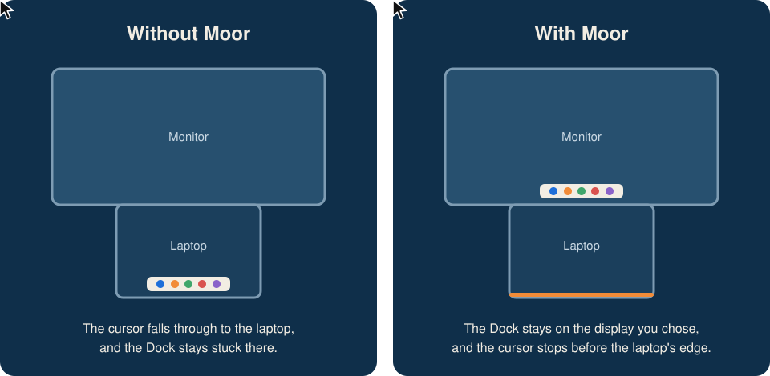
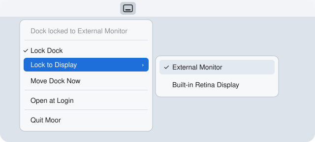

<p align="center">
  
</p>

<h1 align="center">Moor</h1>

<p align="center">Moor your Dock: a small menu bar app that keeps the macOS Dock on the display you choose.</p>

<p align="center">
  
</p>

It is built with stacked setups in mind, such as a large monitor above a laptop. There, the bottom of the monitor is hard to reach because the cursor falls through to the laptop, and the Dock ends up stuck on the laptop.

## How it works

macOS moves the Dock to a display when the cursor presses against that display's Dock edge. Moor uses this in two ways:

- **Blocking.** An event tap holds the cursor a few points away from the Dock edge on every other display, so the Dock has no reason to leave. Edges shared with another display are not blocked, so you can still move between screens.
- **Moving.** When the Dock is on the wrong display, the app briefly presses the cursor against the longest free part of the chosen display's edge, then puts the cursor back. If that fails, it waits for a layout change or a click on **Move Dock Now** rather than grabbing the cursor again.

## Install

Moor is built from source for now, which takes about a minute. You don't need the full Xcode app.

**You'll need** macOS 13 or later and Xcode Command Line Tools. If you don't have the tools yet, install them first:

```sh
xcode-select --install
```

**1. Download and build Moor**

```sh
git clone https://github.com/rooonny/moor-dock.git
cd moor-dock
./scripts/build-app.sh
```

**2. Move it to Applications and open it**

```sh
cp -R build/Moor.app /Applications/
open /Applications/Moor.app
```

**3. Allow Accessibility access**

macOS asks for this on first launch. Turn on **Moor** in System Settings > Privacy & Security > Accessibility. Moor needs this to watch cursor movement and to post the events that move the Dock.

**4. Choose your display**

Click the Moor icon in the menu bar, then pick a screen under **Lock to Display**. The cursor jumps to that screen's edge for a moment and comes back: that's Moor moving the Dock. To start Moor automatically, turn on **Open at Login**.

<p align="center">
  
</p>

Moor needs **Displays have separate Spaces** turned on in System Settings > Desktop & Dock.

### Update

Run `git pull` in the `moor-dock` folder, then repeat steps 1 and 2. Each build counts as a new app for macOS, so if Moor asks for access again, remove its old entry from the Accessibility list and add it again.

### Uninstall

Choose **Quit Moor** from the menu, delete `/Applications/Moor.app`, and remove Moor from the Accessibility list.

## Tested on

A 2560x1440 monitor above a MacBook, with the Dock at the bottom, on macOS 27.2. Other layouts should work but haven't been tried yet, so reports are welcome.

## Known limitations

- The last few points at the Dock edge of other displays can't be reached, which affects hot corners and anything else placed there.
- If another display covers the chosen display's whole edge, there may be nothing for the cursor to press against. Moving one display sideways in System Settings > Displays > Arrange leaves a free stretch.
- With an auto-hidden Dock the app asks the Dock for its position, which is less reliable on stacked displays.

## Development

```sh
swift test
```

The display geometry lives in `Sources/DockGeometry` and has no system dependencies, so it can be tested without any monitors attached.

To regenerate the app icon, run `swift scripts/make-icon.swift`.

## Similar projects

[DockAnchor](https://github.com/bwya77/DockAnchor) and [DockCleat](https://github.com/aitiotekt/dock-cleat) solve the same problem and are also MIT licensed.

## License

MIT. See [LICENSE](LICENSE).
