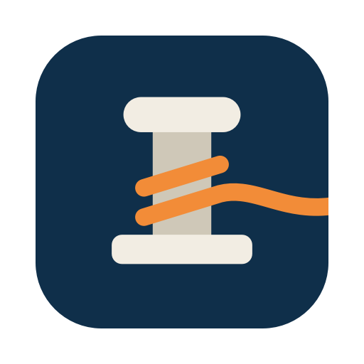

<p align="center">
  
</p>

<h1 align="center">Moor</h1>

<p align="center">Moor your Dock: a small menu bar app that keeps the macOS Dock on the display you choose.</p>

It is built with stacked setups in mind, such as a large monitor above a laptop. There, the bottom of the monitor is hard to reach because the cursor falls through to the laptop, and the Dock ends up stuck on the laptop.

## How it works

macOS moves the Dock to a display when the cursor presses against that display's Dock edge. Moor uses this in two ways:

- **Blocking.** An event tap holds the cursor a few points away from the Dock edge on every other display, so the Dock has no reason to leave. Edges shared with another display are not blocked, so you can still move between screens.
- **Moving.** When the Dock is on the wrong display, the app briefly presses the cursor against the longest free part of the chosen display's edge, then puts the cursor back. If that fails, it waits for a layout change or a click on **Move Dock Now** rather than grabbing the cursor again.

## Requirements

- macOS 13 or later
- Xcode Command Line Tools (`xcode-select --install`)
- **Displays have separate Spaces** turned on in System Settings > Desktop & Dock

## Build and run

```sh
./scripts/build-app.sh
open build/Moor.app
```

On first launch, allow Moor under System Settings > Privacy & Security > Accessibility. It needs this to watch cursor movement and to post the events that move the Dock.

Builds use an ad-hoc signature, so macOS treats each rebuild as a new app. If the app asks for access again after a rebuild, remove its old entry from the Accessibility list and add it again.

## Tested on

A 2560x1440 monitor above a MacBook, with the Dock at the bottom, on macOS 27.2. Other layouts should work but haven't been tried yet, so reports are welcome.

## Known limitations

- The last few points at the Dock edge of other displays can't be reached, which affects hot corners and anything else placed there.
- If another display covers the chosen display's whole edge, there may be nothing for the cursor to press against. Moving one display sideways in System Settings > Displays > Arrange leaves a free stretch.
- With an auto-hidden Dock the app asks the Dock for its position, which is less reliable on stacked displays.

## Development

```sh
swift test
```

The display geometry lives in `Sources/DockGeometry` and has no system dependencies, so it can be tested without any monitors attached.

To regenerate the app icon, run `swift scripts/make-icon.swift`.

## Similar projects

[DockAnchor](https://github.com/bwya77/DockAnchor) and [DockCleat](https://github.com/aitiotekt/dock-cleat) solve the same problem and are also MIT licensed.

## License

MIT. See [LICENSE](LICENSE).
